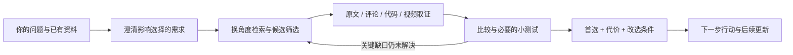
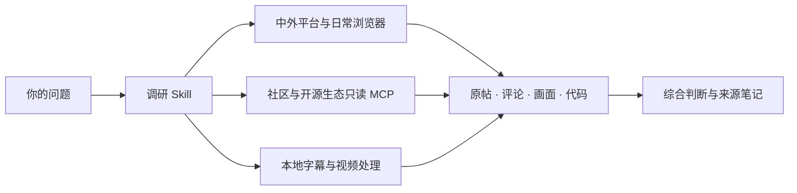

# Research-to-Decision

**让 AI 查得深、比得清，最后帮你选。**

从“给你一堆链接”到“按你的情况，选这个”。主动理清需求，换角度搜到真正合适的方案，读原文、评论、代码和视频，再给出有依据的取舍与下一步。

**需求澄清 · 自适应检索 · 跨平台多模态证据 · 条件推荐 · 小样本验证 · 持续更新**

[安装与触发](docs/installation.md) · [决策效果示例](examples/research-to-decision.md) · [同类比较](docs/comparison.md) · [真实验收](docs/verification.md) · [技术与来源](docs/third-party.md)

Research-to-Decision 是 **OpenInquire 的升级版**，由原仓库更名，保留提交历史。保留中文平台深读、21 个只读 MCP 工具和本地视频处理，新增基于 **BMad Deep Recon 原版** 的研究与决策入口。工具选型、学习路线、产品比较、项目方案，都可以从一句自然语言问题开始。

> **“用调研抉择帮我选。我不确定该看哪些条件，你先补查遗漏的需求；比较实际利弊，告诉我首选、代价，以及什么情况下应该换一个。有必要就做个小演示。”**

## 看完就能选，而不是看完继续问

| 常见卡点 | 这套流程怎么处理 | 你拿到什么 |
| --- | --- | --- |
| 不懂这个领域，不知道该提哪些要求 | 从已有对话、领域方法、失败案例和真实用户反馈补出候选标准，只问会改变排序的问题 | 已确认需求、需要讨论的遗漏项、具体选择题 |
| 搜来搜去都是同一批结果 | 按任务产物、领域术语、相邻路线、平台约束和反例调整查询 | 不同解决思路，以及为什么换检索角度 |
| 每个项目都“强大、灵活、适合深度研究” | 读实际入口和实现，用同一任务比较能力、代价和缺口 | 首选、最强替代项、具体淘汰原因 |
| 大仓库 Star 很多，不知道单个功能好不好 | 区分仓库 Star、单项安装量、维护状态和真实功能证据 | 有日期和统计口径的热度数据，避免借整个仓库替单项背书 |
| 想看效果，却只收到宣传复述 | 值得测时做同题小样本；否则查看官方演示和源码，分别标记 | 输入、关键输出、局限和未验证部分 |
| 建议太绝对，或者所有选项都“可以” | 说明当前条件下选谁、牺牲什么，以及哪条条件变化会改选 | 能行动的条件推荐，不强凑三个方案或虚构评分 |

## 底层用什么，效果落在哪里

| 技术或方法 | 实际用途 | 实现归属 |
| --- | --- | --- |
| **自适应查询扩展** | 搜索结果重复或缺项时，换任务表述、领域词、来源与反证角度 | 本项目的[检索与决策入口](skills/research-decide/SKILL.md) |
| **原生研究工作流 + 可选多 Agent 评审** | Run 直接研究，Process 处理已有报告，Refresh/Deepen 更新旧判断；支持独立提取与审阅 | 随包提供的 [BMad Deep Recon](skills/bmad-deep-recon/SKILL.md)，实际并行依赖宿主 |
| **需求启发与反证方法库** | 帮用户发现遗漏条件，追问最可能改变选择的缺口 | [BMad Advanced Elicitation](skills/bmad-advanced-elicitation/SKILL.md)，按需调用 |
| **跨来源证据核对** | 区分官方声明、源码、实测和经验；转载或两个模型赞同不算两份独立证据 | 原版研究流程与本项目[决策约定](skills/research-decide/references/decision-contract.md) |
| **登录态浏览器 + 21 个只读 MCP 工具** | 从中文原帖、评论到海外社区与开源实现，按任务取证 | OpenInquire 原有能力；浏览器和专用适配器由宿主提供 |
| **FFmpeg + 本地 faster-whisper** | 将取得的视频变成带时码转写、关键帧和可核对的步骤 | 原有本地视频助手；模型与依赖另装 |

这是一套可检查、可改配置的 Agent 工作流：复用成熟研究流程，把平台证据接到选择上。它不需要你维护一张复杂评分表，也不要求每个小问题跑完整研究。主张与实现的对应关系、上游版本和许可见[来源说明](docs/third-party.md)。



## 两个入口，按目的触发

- **要选方案：** 说“调研抉择”“利弊抉择 skill”，或明确指定 `$research-decide`。
- **只要找材料、读收藏或学视频：** 指定 `$chinese-platform-research`，继续使用原有平台调研流程。
- **要找 skill：** 决策入口可调用已安装的 `find-skills` 发现候选；没有它也能直接查目录和仓库。两个入口不会递归把任务转来转去。

下面是保留的平台搜集与多模态能力。

## 让 AI 帮你刷资料，消化收藏

转发过、收藏过的好内容，可以变成以后找得到、用得上的知识与素材。OpenInquire 让 Agent 从你指定的主题、分享会话或收藏链接开始，筛选、读原作、保存素材，再按项目留下简短笔记。

| 你可以直接说 | 留下什么 |
| --- | --- |
| **“把我新转发的抖音学一下，接着上次的断点。”** | 逐条核作品、去重；读转写和关键画面，保存具体步骤、时码与原件 |
| **“整理这批小红书收藏链接，按项目分类。”** | 原文、图片及来源，精简知识卡、项目索引和待补项；已有资料继续复用 |
| **“这些照片留作构图和调色参考。”** | 原图与图序，构图/光线/色调标签，教程参数及适用条件 |
| **“围绕这个主题浏览30分钟，最多选20条值得学的。”** | 有限范围内筛选候选，深入相关内容，记录已读范围与下一断点 |

微信文件传输助手也可作为资料入口：通过宿主另配的桌面控制插件读取指定消息，公开文章和视频交给相应 Reader。浏览器与桌面插件按实际环境连接；本轮浏览的主题、范围和停止点由当前请求确定。

**已验证抖音指定分享、图集与视频学习、桌面微信接续。** 小红书已有搜索/原帖读取流程；收藏页批量读取须先在当前登录与页面做小样本验收，已有链接列表可按同一归档流程整理。[完整工作流](skills/chinese-platform-research/references/shared-inbox.md) · [验收范围](docs/verification.md)

## 难接入的平台，我们怎么读

**针对登录、动态页面和视频内容，按平台选择读取方式。** 浏览器负责站内搜索和页面读取，专用 MCP 与适配器负责内容提取，本地脚本负责视频转写和抽帧。Agent 再将取得的材料读完、核对，整理成有出处的结论。

| 平台或材料 | 我们采用的方案 | 解决的具体问题 |
| --- | --- | --- |
| 抖音与本地视频 | 浏览器核对作品 ID，取得页面提供的媒体；FFmpeg 解码、离线 ASR、定时与场景变化抽帧 | 将口播和画面变成可查阅、带时间点的材料，后台处理时可继续其他工作 |
| 小红书、知乎 | 在用户已连接的日常浏览器中搜索，读取页面 DOM、原图与展开的评论 | 复用现有登录态，读取站内原帖、具体回答和动态加载的内容 |
| B站 | 连接 `bilibili_mcp`、`bili-note` 或正常网页，按任务读取搜索结果、图文、字幕和评论 | 为视频发现、内容提取与学习笔记选择合适工具，保留来源与素材 |
| 微信公众号 | 用 `wechat_public` 发现文章，公开直链通过文章适配器或正常网页提取正文、图片和元数据 | 将搜索线索继续追到可正常访问的文章原文，并核对图文是否完整 |
| 海外社区与开源生态 | REST/JSON/Atom/GraphQL 等来源封装为只读 MCP，按权限与任务选择 | 直接检索帖子、仓库、评论、版本与依赖信息，再按需深读原始内容 |

历史样本已完成公众号正文与图片导出、抖音视频转写与抽帧。浏览器和平台适配器按[安装说明](docs/installation.md)连接；各平台当前可读到哪一层、哪些环节仍受限制，见[实测记录](docs/verification.md)。具体做法见[中文平台](skills/chinese-platform-research/references/local-channels.md)、[公众号](skills/chinese-platform-research/references/wechat-articles.md)、[视频学习](skills/chinese-platform-research/references/douyin-video-learning.md)和[技术平台](skills/chinese-platform-research/references/tech-platforms.md)。

在小红书、知乎、公众号里找实践经验，在 Reddit、Hacker News、Stack Exchange 里找讨论与反例，再到 GitHub、Hugging Face 和视频平台核对实现。OpenInquire 把这些来源放进同一轮调研：评论有没有推翻原帖？视频里的方法能否复刻？已有项目做到哪一步，自己的想法还剩多少新东西？

**把来回搜、翻、看、比较的工作交给 OpenInquire，把精力用在选题、验证和创造上。**

## 为什么选择 OpenInquire

- **抖音、小红书、B站、公众号有专门的读取流程。** 把登录态浏览器、平台适配器、正文提取和视频处理组合起来，让 Agent 按内容类型选择工具，继续读取站内材料。
- **覆盖广：国内经验与海外一手资料一起查。** 中文内容平台、海外社区、代码仓库、模型与数据集、软件包和产品目录都有对应入口；按问题选来源，跨语言核对同一件事。
- **读得深：正文、图片、评论、字幕、视频画面和代码都能成为材料。** 跟进作者更正、楼中讨论、教程步骤和实现细节，让关键结论有原文、评论链接或时间点可查。
- **视频能在后台处理。** 已取得的媒体交给 FFmpeg 与离线 faster-whisper，生成带时码转写、字幕、关键帧和联系表；Agent 再结合文字与画面整理教程、案例和学习笔记。
- **已有资料可以接着用。** 精简候选先供 Agent 筛选，完整结果和日志留在本地；已读来源、素材和未决问题可以复用，换问题、补证据、做长专题时少从头再查。

## 与同类工具对比

| 你熟悉的工具 | 它主打的环节 | OpenInquire 接着帮你完成 |
| --- | --- | --- |
| [Agent Reach](https://github.com/Panniantong/Agent-Reach) | 配好渠道，让 Agent 能访问互联网 | 选哪些来源、追哪些评论、如何核对冲突说法，再交付主题结论与来源 |
| [OpenCLI](https://github.com/jackwener/OpenCLI) | 把网站变成可调用的命令，复用已登录浏览器 | 围绕研究问题安排跨站搜索、深读、比较和整理，产出可以继续使用的调研材料 |
| [last30days](https://github.com/mvanhorn/last30days-skill) | 从 Reddit、X、YouTube 等来源发现近期讨论并综合 | 补入小红书、知乎、公众号等中文站内经验，把近期线索与历史原文、视频过程及代码实现一起核对 |
| [DyNote](https://github.com/Rimagination/dy-note) | 深入抖音视频、评论、账号与话题，形成学习资产 | 将视频中的观点带到其他平台求证，再对照文章、开发者讨论和公开实现 |
| [Groundwork](https://github.com/SC-Airu/groundwork-skill) | 开工前扫描问题、现有方案和需求缺口 | 深入中文平台原帖与多模态材料，保留已读来源，让专题研究可以持续推进 |

**跨平台发现、原帖与评论深读、视频理解、来源核对、结论交付——在一个调研入口里完成。** [详细对比与能力依据](docs/comparison.md)

## 适用场景

| 你想做的事 | OpenInquire 帮你查清什么 | 你带走什么 |
| --- | --- | --- |
| **少造重复的轮子** | 已有开源项目、成熟组件、实际使用反馈和接入条件 | 可复用方案、选型比较、需要自己补的部分 |
| **找到值得做的选题** | 人们反复遇到的问题、现有方案的不足、不同场景的需求 | 有材料依据的选题方向与可检验的问题 |
| **验证想法，准备复刻** | 相似案例、实现步骤、环境版本、数据与效果证据 | 最小验证方案、复刻路线和关键依赖 |
| **查重查新** | 最接近的论文、项目、产品与历史讨论 | 已有工作对照、具体差异、检索范围和待验证点 |
| **学透教程和案例** | 视频过程、关键画面、字幕与评论补充 | 带时码的学习笔记和可复用素材 |
| **做选题写作与趋势研究** | 近期变化、不同群体的观点、原始出处与反例 | 有来源的素材包、观点比较与后续线索 |

学术选题与查新会进一步跟进论文、官方文档及公开实现；复刻路线会明确输入、环境与验证标准。[各类任务的使用方式](skills/chinese-platform-research/references/use-cases.md)

## 可以直接这样提问

> 我想做【项目】。先找已有实现和使用反馈，比较哪些能直接复用，哪些地方值得自己做。

> 这是我的想法【描述】。查最接近的论文、开源项目和产品，标出相同点、真正的差异，以及怎样用一个小实验验证。

> 最近大家怎么用 AI 学习视频？一起查小红书、B站、Reddit、Hacker News 和 GitHub，比较实际效果、成本和使用条件。

> 研究这个选题。看看小红书、知乎、公众号上分别怎么讨论，找出共识、分歧和容易被忽略的细节。

> 把这组已取得的视频学透：整理步骤、关键画面和时间点，再结合评论里的补充，做成以后能回看的笔记。

> 接着上次的调研，补查没解决的问题，告诉我哪些新材料改变了原来的判断。

## 能查哪些来源，读哪些信息

| 来源 | 平台与内容 | 接入方式 |
| --- | --- | --- |
| 中文经验与长文 | 小红书原帖/图片、知乎回答/文章、公众号图文，以及可展开的讨论 | 日常登录态浏览器、公众号文章适配器 |
| 视频与教程 | 抖音、B站的作品与学习材料；YouTube 视频候选 | 浏览器及 B站专用工具；YouTube MCP 检索；已取得媒体再做字幕/ASR与画面读取 |
| 技术问答与社区 | Hacker News、Stack Exchange、V2EX 的问答/讨论/评论；Lobsters 的话题线索 | 内置只读 MCP；需要原文时继续跟进来源 |
| 海外社交与产品 | Reddit、Bluesky、Mastodon、X、Product Hunt 的帖子、动态和产品线索 | 公开 API、Atom 或已授权 API；[X 浏览器与 API 路线](skills/chinese-platform-research/references/x-research.md)分开验收 |
| 开源项目与实现 | GitHub 仓库、Issue/PR 评论与审查回复；GitLab、Gitee 项目 | 内置只读 MCP 发现与读讨论，代码和文档继续回到原仓库核对 |
| 模型、数据和依赖 | Hugging Face 模型/数据集/Spaces；npm、PyPI、crates.io、Docker Hub 的版本与元数据 | 内置只读 MCP；模型卡和实现按任务进一步读取 |

[具体工具与前提](skills/chinese-platform-research/references/tech-platforms.md) · [中文平台路线](skills/chinese-platform-research/references/local-channels.md)

## 调研开始前，先确认这条路今天能走

每条渠道分别记录搜索、正文、评论和媒体的实测状态。运行时先用小样本确认当前入口，再扩大调研；某一来源暂时失效，已取得的材料保留，其他相关来源继续。

最近一轮分享整理实测：**2026-10-22**，指定抖音分享接续、完整图集归档、视频转写与抽样画面学习，以及桌面微信资料读取。X 网页与基础 MCP 的既有验收仍按原日期保留。各平台按实际测试日期记录可读层级。[查看实测范围](docs/verification.md)

## 一个真实例子：后续回复改变了结论

在调研 Agent Reach 的配置说明时，我们读到一个环境问题报告。作者先在回复里将原因归于本地拷贝，后来又更正判断、补上上游修复提交。继续打开代码，才能核实究竟改了什么。这个过程用本仓库的评论工具读到了三条回复，并核对了原始 diff。[查看案例与来源](examples/comments-change-the-answer.md)

同样的方法可以用来判断一篇经验帖的适用条件、一条视频教程的后续补充，或一个开源方案的实际状态。

## 轻量组合，按需接入



仓库提供调研 Skill、**21 个只读 MCP 工具**和本地处理脚本。浏览器、站点适配器、可选近期检索引擎与语音模型按任务接入，现有工具可以继续使用。[组件与安装说明](docs/installation.md)

当前验收环境为 Windows + Codex。各平台的正文、评论和媒体可用范围单独记录，便于选用合适路线。[查看最新验收](docs/verification.md)

安装到用户级 Skill 目录后，可以在不同项目中调用：

```text
用 $chinese-platform-research 调研【主题】。
关注【时间范围和重点】，先给主要判断，再附能回查的来源。
```

`chinese-platform-research` 是保留兼容的调用名；平台和语言范围按调研问题选择，国内与海外来源均可使用。

## 开源致谢

感谢 [Agent Reach](https://github.com/Panniantong/Agent-Reach)、[OpenCLI](https://github.com/jackwener/OpenCLI)、[last30days](https://github.com/mvanhorn/last30days-skill)、[DyNote](https://github.com/Rimagination/dy-note) 和 [Groundwork](https://github.com/SC-Airu/groundwork-skill) 对渠道检查、浏览器复用、近期发现、视频资产与需求研究的探索。设计参考、可选依赖和代码改编分别记录在[组件关系](docs/comparison.md#组件关系)中。

原创代码与文档采用 [MIT](LICENSE)。视频助手中的 SRT 格式改编保留了 [上游 MIT 许可](skills/chinese-platform-research/scripts/LICENSE.video-transcriber)。其余独立工具按各自许可证安装。
